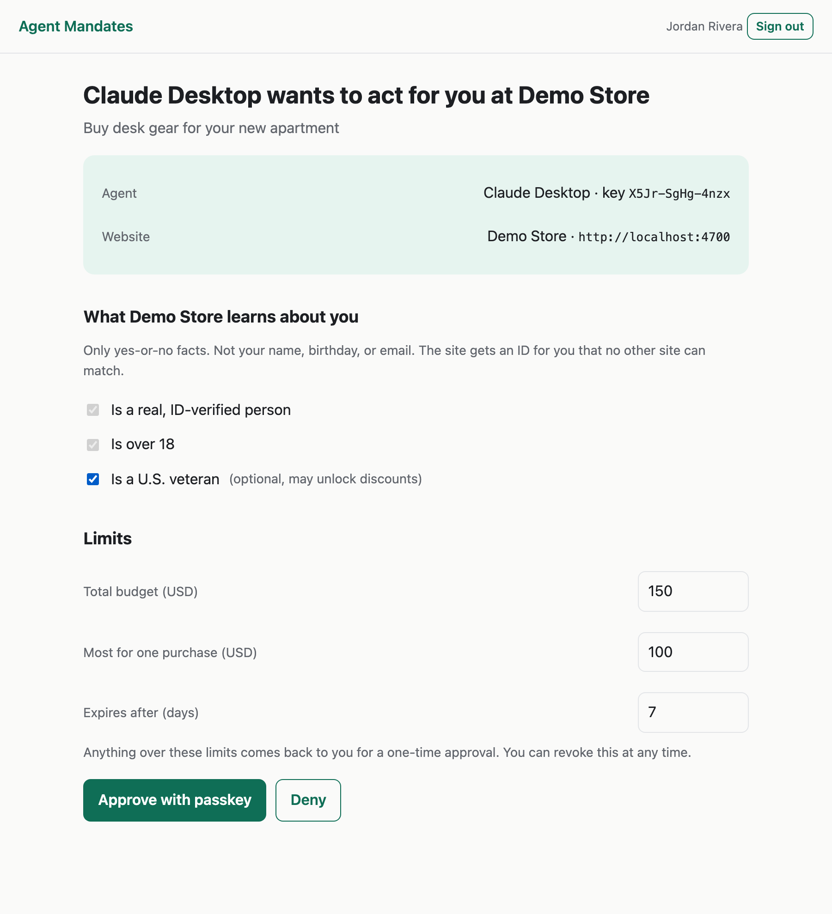

# Agent Mandates

A prototype that lets an AI agent act for an ID-verified person, within limits that person sets. A person signs in with ID.me once, then grants an AI agent a *mandate*: permission to act for them at one website, with a budget, an expiry, and only the facts they choose to share. The website can check, on every request, that a real ID-verified person stands behind the agent and what they allowed. The person can revoke it with one click.

Built on ID.me's OAuth/OpenID Connect login. Runs locally against a mock that speaks the same protocol; the `IDME_*` environment variables point it at the ID.me sandbox instead (see below).



## Motivation

Agents are starting to shop, book, and file things for people. Websites can't tell a person's agent from a bot farm, so they either block agents or trust them blindly. People, meanwhile, have no way to give an agent *limited, revocable* permission, so the choice is between handing over a full login and not using the agent.

Identity-verification logins already know who the person is. Agent Mandates is a thin layer that lets that verification travel with an agent.

## Layout

```
apps/mock-idme      OIDC provider standing in for the ID.me sandbox (code flow + PKCE, id_token, attributes)
apps/mandate        the mandate service: portal for people + APIs for agents and websites
apps/store          Demo Store, a fake shop that accepts agent mandates
packages/verifier   drop-in middleware any website adds to check agents (the "SDK")
packages/agent      agent-side client: key, DPoP proofs, token caching
packages/mcp        MCP server so Claude (or any MCP agent) can use all of this
test/               unit tests for the verifier + a full end-to-end run in headless Chromium
```

## Run it

Needs Node 22.18 or newer (TypeScript runs directly, no build step).

```bash
npm install
npm run dev        # mock ID.me :4000, mandate service :4100, Demo Store :4200
npm run demo       # in a second terminal: plays the agent, hands you links to approve
```

```bash
npm test           # 9 verifier unit tests
npm run e2e        # the whole story end to end, 16 checks, headless (SCREENSHOTS=1 to save PNGs)
```

### Use it from Claude

Add the MCP server to Claude Desktop (`claude_desktop_config.json`) or Claude Code:

```json
{
  "mcpServers": {
    "agent-mandate": {
      "command": "node",
      "args": ["--no-warnings", "/absolute/path/to/agent-mandate/packages/mcp/server.ts"],
      "env": { "AGENT_NAME": "Claude", "AGENT_MANDATE_ISSUERS": "http://localhost:4100" }
    }
  }
}
```

Then ask: *"Get permission to buy me desk gear at http://localhost:4200 with a $150 budget, then buy a keyboard."* Claude calls `request_mandate`, gives you a link, waits with `check_mandate`, and shops with `agent_fetch`. If a purchase is over your limit, it gets a 402, hands you an approval link, and calls `wait_for_approval`. `AGENT_MANDATE_ISSUERS` lists the mandate services the agent will use (comma-separated; the local one by default).

## Architecture

```
            ┌──────────────┐
            │    ID.me     │  proves who the person is (OIDC)
            └──────▲───────┘
                   │ login
┌──────────┐  approve  ┌──────────────────┐  limits check  ┌─────────────────────┐
│  Person  ├──────────►│ Mandate service  │◄───────────────┤ Website + verifier  │
└────┬─────┘           └────────▲─────────┘                └──────────▲──────────┘
     │ approves setup           │ get token (DPoP)                    │ signed request
     │                 ┌────────┴─────────┐                           │
     └────────────────►│ AI agent + MCP   ├───────────────────────────┘
                       │ holds the key    │
                       └──────────────────┘
```

### The four flows

1. **Setup.** The agent calls `POST /api/mandate-requests` with a DPoP proof (that proof *is* its identity: a key pair it generated, whose private half never leaves the machine). The person opens the link, signs in with ID.me, creates a passkey, picks limits and which facts to share, and approves with the passkey. The mandate is now bound to that agent's key.
2. **Normal request.** The agent trades the mandate for a 10-minute token at `POST /api/token`, then calls the website with `Authorization: DPoP <token>` plus a fresh `DPoP` proof. The website's verifier checks everything locally. For a purchase, the site calls `POST /api/transactions/authorize`, which debits the budget.
3. **Step-up.** If a purchase is over the per-purchase limit or the remaining budget, the site answers `402 step_up_required` with an approval link. The person approves *that one purchase* with their passkey. The agent retries with `Agent-Approval: <id>` and the same `Idempotency-Key`.
4. **Revoke.** One click in the portal. Purchases fail immediately (they go through the issuer), no new tokens are issued, and any token already out expires within 10 minutes.

### The token

```json
{
  "iss": "https://mandates.example",
  "aud": "https://demo-store.example",
  "sub": "pw_DxX0eNB3uh3-yrBWatRyVh",
  "act": { "sub": "agent_KMc3C_FAJ0vv...", "name": "Claude Desktop" },
  "claims": { "verified_human": true, "over_18": true, "veteran": true },
  "authorization_details": [{ "type": "purchase", "max_total_usd": 150, "per_purchase_limit_usd": 100 }],
  "mandate_id": "md_...",
  "cnf": { "jkt": "<SHA-256 thumbprint of the agent's public key>" },
  "exp": 1763200000
}
```

| Field | Standard | Why |
|---|---|---|
| `act` | OAuth Token Exchange, RFC 8693 | Says an agent is acting *on behalf of* the subject, not as them |
| `authorization_details` | Rich Authorization Requests, RFC 9396 | Structured limits instead of vague scopes |
| `cnf.jkt` + DPoP proofs | DPoP, RFC 9449 | Binds the token to the agent's key, so a copied token is useless |
| `sub` (pairwise) | OIDC pairwise subject identifiers | Each site gets a different ID for the same person, so the subject alone doesn't link them across sites (the agent's key does; see the gaps below) |
| `typ: mandate+jwt` | RFC 8725 explicit typing | A mandate token can't be confused with any other JWT |

## Design decisions

### Offline checks for identity, one online check for money

Signature, audience, expiry, and key binding are verified by the website with no network call (the issuer's public keys are cached). But "$150 total" depends on history, and only one place knows what has been spent, so money goes through the issuer's `transactions/authorize`, which checks and debits inside a single database transaction. Two purchases racing each other can't both slip past the cap. In Postgres this would be `UPDATE ... SET spent = spent + $1 WHERE id = $2 AND spent + $1 <= cap RETURNING ...`.

### Short tokens instead of revocation lists

Tokens live 10 minutes and the agent quietly fetches new ones while the mandate is live. Revoking stops issuance, so the worst-case window for non-money requests is 10 minutes, and money requests are refused instantly. No website has to poll a revocation list.

### Approvals are bound to one exact purchase

A step-up approval records the amount, the description the person saw, and the purchase reference. It can be used once, for that purchase, within a day, and doesn't raise any limits. The e2e test checks that reusing it for a second item fails, and that a different cart at the same price is refused.

### Idempotency everywhere money moves

The agent sends an `Idempotency-Key`. The ledger has a unique `(mandate_id, reference)`, so a retry after a timeout returns the original transaction instead of charging twice.

### The person approves with a passkey, not a click

A stolen session cookie can browse the dashboard but can't grant a mandate or approve a purchase: each of those needs a WebAuthn assertion over a challenge made for that specific consent or purchase. Adding a passkey needs an ID.me sign-in from the last 10 minutes: the portal sends `max_age=600` and counts the session from the id_token's `auth_time`, so a cookie copied later can't enroll the copier's own passkey. Sessions end on the server after 8 hours.

### Sign-in is bound to the browser that started it

The OIDC `state` is also kept in a short-lived cookie and checked on the callback, so a callback URL made in someone else's browser can't sign this one in. `return_to` only accepts paths on this site, and no portal page can be framed by another site (`frame-ancestors 'none'`).

### The agent only follows issuers it was configured with

A site names the issuer it accepts in `/.well-known/agent-access`, but the agent uses only the issuers in `AGENT_MANDATE_ISSUERS` and drops any approval link that isn't on that issuer. Otherwise a site could get the agent to hand the person a look-alike sign-in page. An agent's name is also fixed the first time its key asks, so it can't rename itself after a person approved it.

### Data minimization by default

The site asks for facts (`verified_human`, `over_18`), not attributes. The person sees exactly what will be shared, and optional facts (like veteran status for a discount) are unchecked until they choose to share them.

## Using the real ID.me sandbox

The mandate service is a standard OIDC client. Register an app in the ID.me developer portal with redirect URI `http://localhost:4100/oauth/callback`, then set:

```bash
IDME_AUTHORIZE_URL=...   IDME_TOKEN_URL=...   IDME_ATTRIBUTES_URL=...
IDME_JWKS_URL=...        IDME_ISSUER=...
IDME_CLIENT_ID=...       IDME_CLIENT_SECRET=...   IDME_SCOPE="openid military student"
```

Take the exact endpoint URLs and scope names (including the policy that gives IAL2 verification) from ID.me's developer documentation; the attribute mapping lives in `apps/mandate/portal.ts` (`/oauth/callback`). So far it has only run against the mock. The mock reports identity verification as a status group named `identity`; check what the sandbox returns for your policy and adjust the mapping to match.

## Toward production

- The identity provider could issue mandate tokens itself through a delegation endpoint, instead of a separate mandate service.
- Someone has to decide who is liable when an agent acts within a mandate and something goes wrong. Limits and audit logs are the evidence; the policy is a business decision.
- Mandates could show up in the provider's wallet app, so revoking one is one tap on the phone.
- Approvals could be pushed to the person's phone (CIBA-style back-channel auth) instead of passed along as a link by the agent.
- If it matters which agent software holds the key, agents would need attestation (for example, a key held in hardware on a known device).

## Known gaps

Infrastructure kept simple for a prototype: SQLite instead of Postgres, an in-memory DPoP replay cache instead of Redis (`SET key NX EX`), one signing key with no rotation schedule, no rate limiting, and HTTP on localhost.

Trust gaps that a real version would need to close:

- The issuer debits a mandate on the site's word. A site with a valid API key can charge without the agent asking. The site should forward the agent's signed purchase request, and the issuer should check it.
- One agent key serves every site that agent uses, so two sites could link the same agent by its key thumbprint even though `sub` differs. A key per site would fix that.
- The agent's name on the consent screen is whatever the agent says it is. The portal can only vouch for the key fingerprint shown next to it, and anyone can send a person an approval link.
- The agent's private key is a plain JWK file (mode 600) in `~/.agent-mandate/`. Anything that can read that file can act as the agent.
- Passkeys have three gaps: a session cookie copied in the first 10 minutes after sign-in could still add one, there is no page to list or remove them, and if the identity provider doesn't return `auth_time` the portal counts from the redirect instead.
- The step-up link is handed to the person by the agent rather than pushed to their phone, and the passkey signs a random challenge, not the amount.
